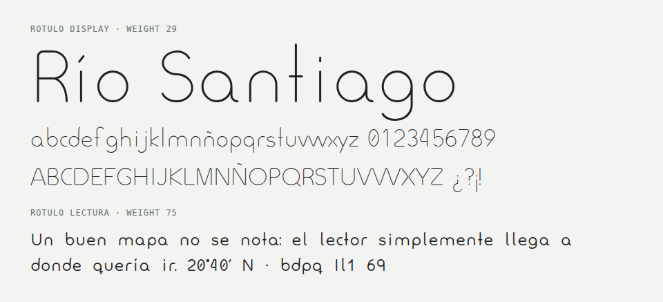

# <picture><source media="(prefers-color-scheme: dark)" srcset=".github/assets/icon-dark.svg"></picture> rotulo

[](LICENSE)

Monoline typeface generated from skeletons: strokes of lines and arcs expanded with a round pen.



Every letter is a skeleton of straight lines and arcs drawn in code, never a hand-drawn outline. The
generator expands each skeleton with a round pen, merges the strokes and writes TrueType fonts. Weight
is the pen width, so a new weight is one parameter away. It ships two styles: **Display**, a light cut
for map labels and titles, and **Lectura**, a heavier, wider-spaced cut with letters that are hard to
mirror, meant for reading.

## Install

```bash
pip install git+https://github.com/GHEgar/rotulo
```

## Quick start

```bash
python -m rotulo --out build
```

```python
from dataclasses import replace
from pathlib import Path

from rotulo import DISPLAY, build_font

medium = replace(DISPLAY, weight=50)
print(build_font(medium, "Medium", 400, Path("build")))
```

## Using the fonts

| Where | How |
|---|---|
| Web | `@font-face { font-family: Rotulo; src: url(Rotulo-Display.ttf); }` |
| GeoServer | Copy the `.ttf` into the font directory and name it in the SLD `font-family` |
| PDF | Embed the `.ttf`; the outlines are static TrueType |

## Styles

| Style | Weight | x-height | Spacing | Letters |
|---|---|---|---|---|
| Display | 29 | 420 | 1.56 | Plain `l`, `q`, `1`, `9` |
| Lectura | 75 | 470 | 1.8, words 1.6 | `l` with a tail, `q` with a crossed tail, curved flag on `1`, straight `9` |

## Parameters

`Params` holds every design decision. The main ones, in units of a 1000 em:

| Field | Default | What it controls |
|---|---|---|
| `weight` | 29 | Pen width |
| `x_height`, `cap_height` | 420, 700 | Body and capital heights |
| `ascender`, `descender` | 800, −260 | Shared by every letter with a tail |
| `corner` | 70 | Radius used to round every skeleton vertex |
| `gap` | 110 | Space between a stroke and a floating detail (dots, accents, the zero slash) |
| `spacing`, `word_spacing` | 1.56, 1.0 | Side bearings and space width |
| `narrow_air` | 0.3 | Extra room around narrow letters such as `i`, `l`, `t` |
| `aperture` | 70 | Opening of `c` and `C` |

## Known limitations

- Static fonts only. The variable `wght` axis needs a stroker that keeps the same outline structure
  across weights.
- Latin set for Spanish: basic Latin, Spanish accents, figures and common punctuation.
- Details (dots, accents, the zero slash) are drawn in the text color; a second tone would need COLRv1.

## Development

```bash
python -m venv .venv && . .venv/bin/activate
pip install -e '.[dev]'
pytest
ruff check src tests && ruff format --check src tests
mypy
```

The tests build both fonts and check that heights match the skeleton and that kerning is present.

## Contributing

Issues are welcome. Please open one before sending a pull request.

## License

OFL-1.1 © GHEgar
